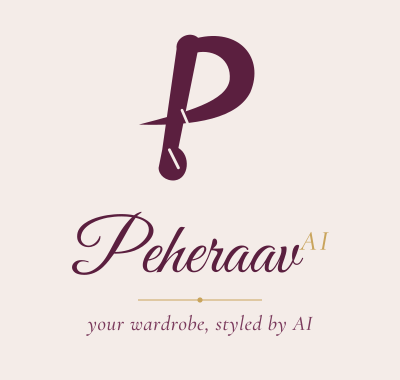
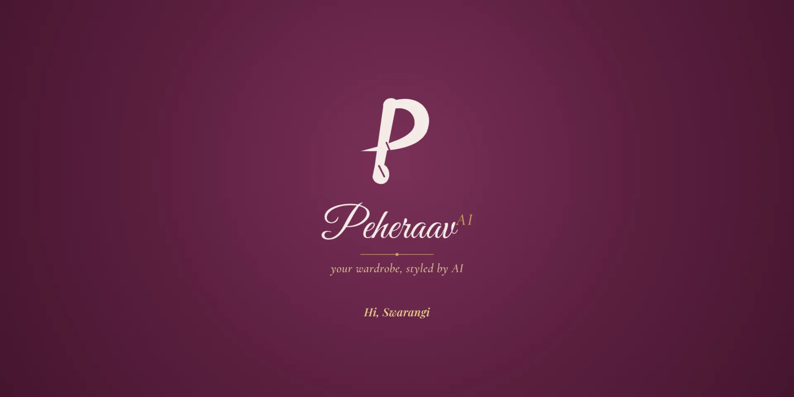
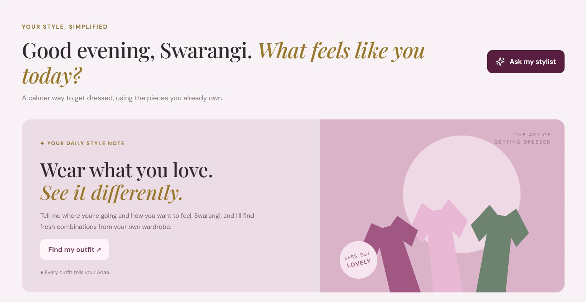
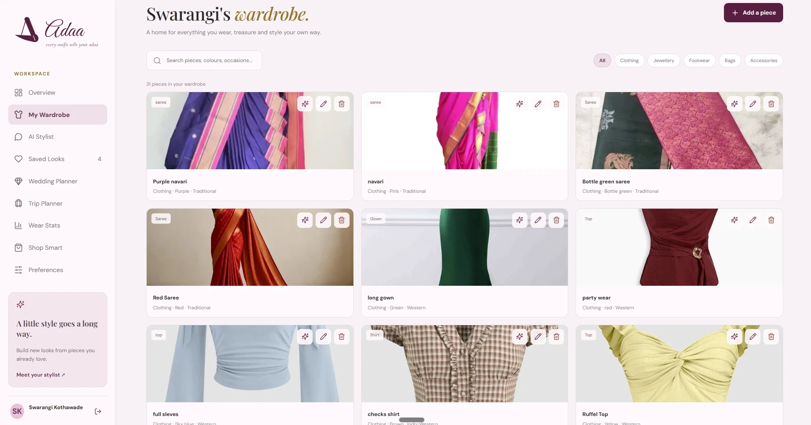
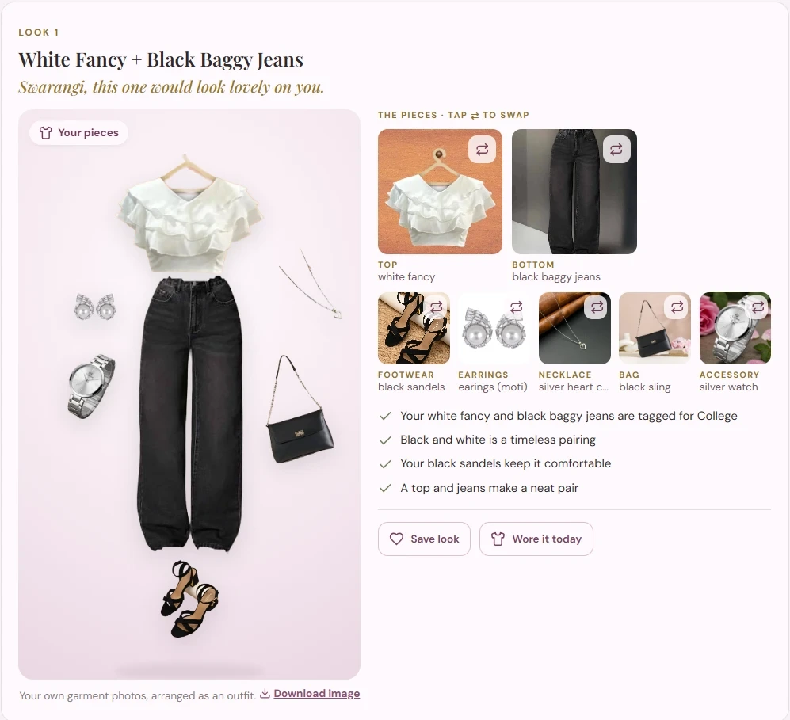
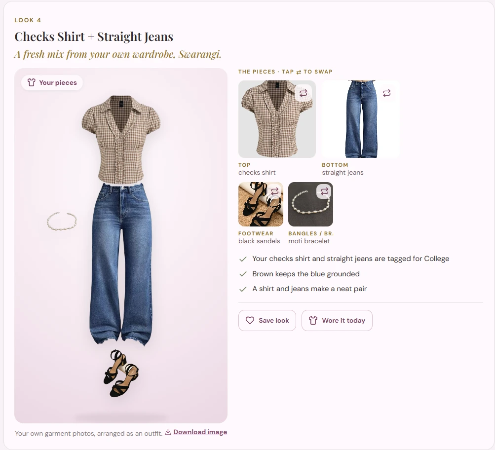
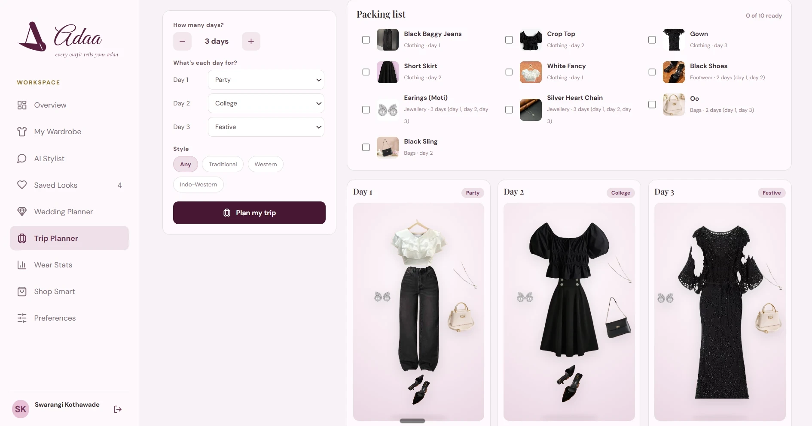
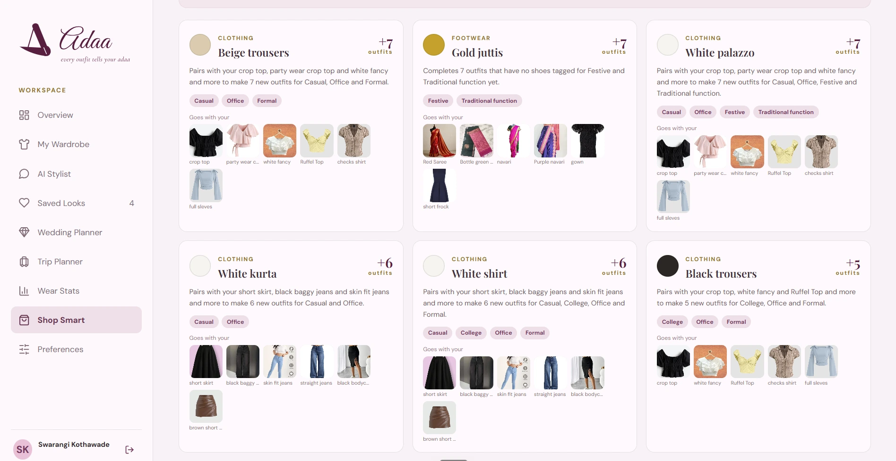
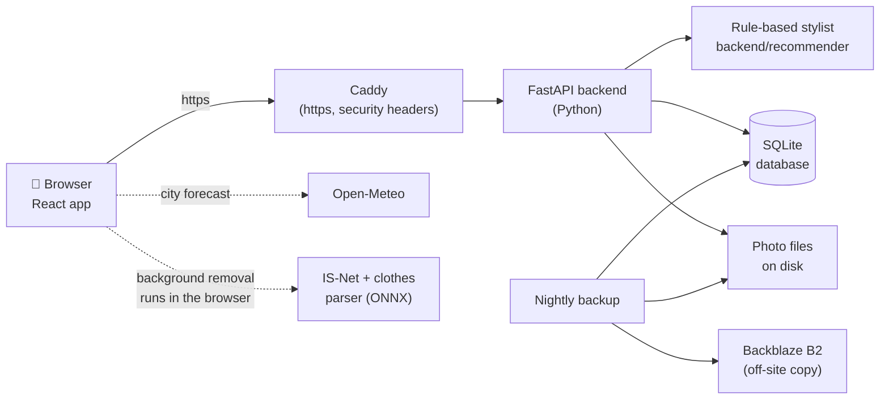
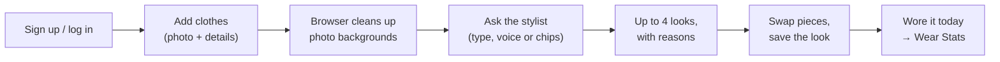

<p align="center">
  
</p>

<h1 align="center">Peheraav AI</h1>

<p align="center"><b>Your wardrobe, styled by AI.</b><br>
A personal wardrobe stylist that builds complete outfits from the clothes you already own.</p>

<p align="center">
  <a href="https://peheraav-ai.eastasia.cloudapp.azure.com"></a>
  
  
  <a href="LICENSE"></a>
  
  
  
</p>

<p align="center">
  
</p>

---

## Contents

[Problem and solution](#the-problem) · [Features](#features) · [Screenshots](#screenshots) · [Tech stack](#tech-stack) · [How it works](#how-it-works) · [Project structure](#project-structure) · [Security and privacy](#security-and-privacy) · [Links](#links) · [Roadmap](#roadmap) · [Credits](#credits-and-contributing) · [License](#license)

## The problem

Most of us have a full wardrobe and still feel we have "nothing to wear". We forget what we own, repeat the same few outfits, and buy new clothes that don't go with anything. Generic fashion apps don't help much: they suggest clothes you don't have, or ignore Indian wear like sarees, kurtas and lehengas.

## The solution

Peheraav is a stylist for **your own** wardrobe. You add photos of your clothes, jewellery, shoes and bags once. Then you ask in plain words (*"Aaj college ke liye kuch comfy"*) and Peheraav puts together complete looks, **only from pieces you really own**, and explains why each one works.

> **The core rule:** Peheraav never invents a piece. If something is missing (no bag, nothing tagged for a wedding, "my green kurta" when you don't have one), it says so and shows the best real combination instead.

## Features

| Feature | What it does |
|---|---|
| 👗 **My Wardrobe** | Add pieces with a photo and details; search, filter, edit, delete. **Auto-fill** reads the photo and suggests the category, type and colour |
| ✨ **AI Stylist** | Ask by typing or **voice**, in English or **Hinglish**, or pick occasion, style and colours. Get up to 4 different outfits, each with reasons and honest cautions |
| 🖼️ **Outfit boards** | Each look is shown as a board of your **own garment photos**, with backgrounds removed in your browser (no AI-generated images). Download it as a picture to share |
| 🔁 **Swap and save** | Swap any piece for another that still works, save looks, add your own photo wearing a look, mark *"Wore it today"* |
| 💍 **Wedding Planner** | A different look for each function (haldi, mehendi, sangeet, wedding, reception…) following the usual dress codes, with no garment repeated, plus a get-ready list |
| 🪔 **Festivals** | About 30 festivals and national days with their colours (*"Style me for Diwali"*, Navratri's colour of the day) |
| 🧳 **Trip Planner** | One outfit per day of a trip with no garment worn twice, and a packing list |
| ☀️ **Weather-aware** | Uses today's forecast for your city: lighter pieces when it's hot, layers when it's cold, a caution about heels in the rain |
| 📊 **Wear Stats** | Pieces not worn in 30/60/90 days, most worn, and cost per wear |
| 🛍️ **Shop Smart** | The few new pieces that would unlock the most outfits with what you already own (ideas only; Peheraav never sells) |
| 💜 **Style profile** | Optional height, body shape, fit, undertone and colours you love or avoid. Each look then explains **"Why it suits you"** |
| 🔐 **Accounts** | Email + password, a private wardrobe per person, email confirmation, password reset, delete account. Peheraav greets you by name |
| 📱 **Phone-friendly** | Works in any modern browser and can be added to the home screen like an app |

## Screenshots

> Screenshots of the real app with a real wardrobe. Nothing is mocked up or AI-generated.

<table>
  <tr>
    <td width="50%" align="center"><b>Overview</b><br><sub>A personal greeting and the daily style note</sub></td>
    <td width="50%" align="center"><b>My Wardrobe</b><br><sub>Every piece with its photo, category, colour and style</sub></td>
  </tr>
  <tr>
    <td></td>
    <td></td>
  </tr>
  <tr>
    <td width="50%" align="center"><b>A college look</b><br><sub>Outfit board made from the user's own photos, with reasons</sub></td>
    <td width="50%" align="center"><b>Another look for the same request</b><br><sub>Up to 4 different looks, each piece swappable</sub></td>
  </tr>
  <tr>
    <td></td>
    <td></td>
  </tr>
  <tr>
    <td width="50%" align="center"><b>Trip Planner</b><br><sub>One outfit per day, no garment repeated, plus a packing list</sub></td>
    <td width="50%" align="center"><b>Shop Smart</b><br><sub>The new pieces that would unlock the most outfits</sub></td>
  </tr>
  <tr>
    <td></td>
    <td></td>
  </tr>
</table>

## Tech stack

| Layer | Technology | Used for |
|---|---|---|
| Frontend | **React 18 + Vite**, plain CSS, Lucide icons | The screens; one API file (`api.js`) talks to the backend |
| Backend | **Python + FastAPI** (Uvicorn) | The API, accounts, photo checks and the styling rules |
| Database | **SQLite** (one file, WAL mode) | Accounts, wardrobe, looks, history, style profiles |
| Styling "brain" | **Rule-based Python** (`backend/recommender/`) | Outfits, request understanding, planners, festivals, weather. No paid AI service |
| In-browser AI | **onnxruntime-web** with **IS-Net** and a **SegFormer-B2** clothes parser | Removing photo backgrounds and auto-fill, inside the user's browser |
| Weather | **Open-Meteo** (free, no key) | Today's forecast for the user's city |
| Voice | Browser **Web Speech API** | Speaking a request |
| Hosting | Ubuntu server on **Azure for Students**, **Caddy** (https), **systemd** | Running the live app |
| Backups | Nightly `backup.py` + off-site copy to **Backblaze B2** | Keeping data safe |
| Email | Any SMTP service (Gmail app password in production) | Email confirmation and password reset |
| Tests | **pytest** (258 tests) | Checking the backend and styling rules |

## How it works



**A typical visit:**



- **How outfits are chosen:** every piece is classified (kurta → top, palazzo → bottom, jhumkas → earrings). Peheraav builds every sensible top + bottom pair or one-piece, scores it (occasion tags, style, colour harmony, weather, style profile), adds shoes, jewellery and a bag, then picks up to 4 looks that really differ.
- **Why rules instead of a chatbot:** it can only pick from your items, so it can't "hallucinate" a piece. Every suggestion comes with the real reasons, it's free to run, and it gives the same answer every time, so it can be tested.

More detail: [docs/ARCHITECTURE.md](docs/ARCHITECTURE.md) · Project report (PDF): [docs/PEHERAAV_AI_Project_Report.pdf](docs/PEHERAAV_AI_Project_Report.pdf)

## Project structure

```
Peheraav/
├─ backend/                  Python + FastAPI
│  ├─ main.py                App setup, middleware, serves the built app on a server
│  ├─ config.py              All settings (paths, limits, email, backups)
│  ├─ auth.py, routes/auth.py  Accounts: password hashing, sessions, email links
│  ├─ routes/                API routes: items, recommendations, looks, planner, profile
│  ├─ recommender/           The rule-based stylist: engine, parser, colours, garments,
│  │                         planner, events (weddings), festivals, weather, profile_fit
│  ├─ database.py, looks_db.py  SQLite tables and queries
│  ├─ storage.py, image_meta.py  Photo checks, saving, removing hidden photo data
│  ├─ ratelimit.py, security.py  Request limits, cross-site check, Content Security Policy
│  ├─ backup.py, offsite.py  Nightly backup and off-site copy
│  ├─ mailer.py              Sends emails (or prints them when no email is set up)
│  └─ tests/                 258 pytest tests
├─ frontend/                 React + Vite
│  ├─ public/                Icons, logo files, web app manifest, robots.txt
│  └─ src/
│     ├─ App.jsx, Root.jsx   Layout, navigation, opening animation, log-in screen
│     ├─ api.js              Every call to the backend
│     ├─ pages/              Wardrobe, Stylist, SavedLooks, WeddingPlanner, TripPlanner, WearStats, ShopSmart
│     ├─ components/         Outfit board and cards, forms, account and legal dialogs…
│     └─ cutout*.js          Background removal in a Web Worker (onnxruntime-web)
├─ deploy/                   Server install/update scripts, systemd services, Caddyfile, settings example
├─ brand/                    Logo files, colours and fonts
└─ docs/                     Architecture, deploy guide, testing log, demo script,
                             project report (PDF) and screenshots
```

## Security and privacy

| Area | What Peheraav does |
|---|---|
| Passwords | Never stored; only a salted **scrypt** hash |
| Sign-in | A random session token in an **HttpOnly, SameSite** cookie (Secure on https); the database stores only its SHA-256 |
| Brute force | 5 wrong passwords per email in 15 minutes, plus per-address limits on sign-up, log-in, reset emails and uploads |
| Data separation | Every query is filtered by the logged-in user, so one account can never see another's wardrobe |
| Photos | Real file type checked, random file names, shrunk in the browser, hidden location data removed on the server too |
| Web attacks | Cross-site write requests blocked, strict **Content Security Policy**, no third-party scripts or fonts |
| Email links | One-use, short-lived, hashed; sent after `#` so they never appear in server logs |
| Data | Delete your account any time; nightly backups with an off-site copy; server logs kept 30 days |

Details: the *Launch hardening* section of [docs/ARCHITECTURE.md](docs/ARCHITECTURE.md).

## Links

| | |
|---|---|
| 🌐 **Live app** | https://peheraav-ai.eastasia.cloudapp.azure.com |
| 📱 **Google Play** | Coming soon |
| 📄 **Project report** | [docs/PEHERAAV_AI_Project_Report.pdf](docs/PEHERAAV_AI_Project_Report.pdf) |
| 🏗️ **Architecture** | [docs/ARCHITECTURE.md](docs/ARCHITECTURE.md) |
| 🚀 **Deploy guide** | [docs/DEPLOY.md](docs/DEPLOY.md) |
| 🧪 **Testing log** | [docs/TESTING.md](docs/TESTING.md) |
| 🎤 **Demo script** | [docs/DEMO.md](docs/DEMO.md) |
| 🎨 **Brand** | [brand/README.md](brand/README.md) |

## Roadmap

**Planned**
- 📱 Android app on **Google Play** (the web app wrapped as a Trusted Web Activity)
- 🌐 Own domain and a transactional email service, so emails reach the inbox instead of spam
- 📴 An offline screen when there's no internet

**Ideas**
- Rank pieces you haven't worn lately higher in the stylist
- Makeup suggestions to go with a look
- An optional free local language model for friendlier chat (the rules would still choose the clothes)

**Known limitations**
- Requests are understood by keyword rules: clear sentences work best, and Peheraav shows what it understood.
- Auto-fill is a suggestion: on 28 real photos it got the category right every time, the type about 9 in 10 and the colour about 3 in 4.
- Phones skip automatic background removal (the model is about 200 MB); those pieces get a clean cut-out the next time the account is opened on a computer.
- One server and one SQLite file: right for friends and early users, not for very large numbers.
- The clothes-parser model's licence (NVIDIA) allows **non-commercial use only**; a commercial version would need a differently licensed model.

## Credits and contributing

**Created by** [Swarangi Kothawade](https://github.com/SwarangiK-21).

**Built on open source:** [FastAPI](https://fastapi.tiangolo.com), [React](https://react.dev), [Vite](https://vite.dev), [onnxruntime-web](https://onnxruntime.ai) (MIT), [IS-Net](https://github.com/xuebinqin/DIS) via the [rembg](https://github.com/danielgatis/rembg) project (Apache 2.0), [SegFormer-B2 clothes parser](https://huggingface.co/Xenova/segformer_b2_clothes) (NVIDIA licence, non-commercial), [Open-Meteo](https://open-meteo.com), [Lucide](https://lucide.dev) icons, and DM Sans and Playfair Display fonts via [Fontsource](https://fontsource.org) (SIL Open Font License).

**Contributing:** this is a student project. Ideas and bug reports are welcome as GitHub issues. For code changes, please open an issue first, keep changes small, and make sure `python -m pytest` and `npm run build` pass.

## License

Peheraav's source code is released under the **[MIT License](LICENSE)**: you may use, copy, change and share it, as long as the copyright notice is kept.

The MIT License covers this repository's code and documentation only. The AI models Peheraav downloads at runtime keep their own licences: IS-Net is Apache 2.0, and the SegFormer-B2 clothes parser is under an NVIDIA licence that allows **non-commercial use only**. A commercial version of Peheraav would need a differently licensed clothes model. The Peheraav name and logo identify this project; please don't present a modified version as the official Peheraav.
