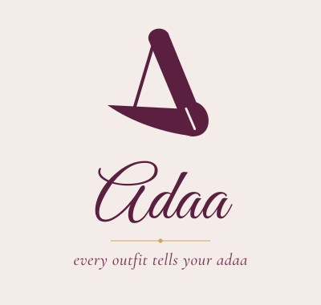

<p align="center"></p>

# Adaa

**Every outfit tells your Adaa.**

Adaa is a personal wardrobe stylist. You photograph and register your own clothes, jewellery, footwear and bags; Adaa then suggests complete, coordinated outfits for an occasion, using **only pieces you actually own**. It supports Indian traditional, Western and Indo-Western styling.

It runs entirely on your own computer with free, open-source tools: no paid APIs, no cloud, no account.

## What it does

| Feature | Where |
|---|---|
| Add pieces with a photo and details (category, type, colour, style, occasions), then search, filter, edit and delete them. **Auto-fill** reads the photo and suggests the category, type, colour, style and a name | **My Wardrobe** |
| Ask in plain words, in English or **Hinglish** (*"Aaj college ke liye kuch comfy"*, *"Shaadi ke liye kuch lal aur bhaari"*), by typing or by **voice**, or pick occasion, style, colour, colour mood and comfort | **AI Stylist** |
| Get up to 4 distinct outfits, each with a **large full-body preview**, your product photos, reasons and honest cautions | **AI Stylist** |
| Swap any piece for another one from your wardrobe that still works | Outfit cards |
| Save looks, rename them, add **your own photo** wearing a look, mark "Wore it today", and see your outfit history | **Saved Looks** |
| **Wedding planner:** pick the functions (haldi, mehendi, sangeet, wedding, reception, engagement, cocktail, puja); get a different look for each that follows the usual dress code (yellow for haldi, green for mehendi, no all-white at the wedding...), no garment repeated, plus a get-ready list | **Wedding Planner** |
| **Festivals:** ask *"Style me for Republic Day"*, *"ganesh chaturti"*, *"Makar Sankranti"*, *"Diwali party"*… (30 festivals and national days, typos and Hinglish fine); you get **only outfits in the festival's colours** (or the colour you name, e.g. *gulabi*), and each says why. The Overview shows today's festival (Navratri: today's colour) or the next one | **AI Stylist**, **Overview** |
| **Plan a trip:** choose the occasion for each day; get a different outfit for every day (no garment worn twice; shoes, bags and jewellery are reused), plus a packing checklist | **Trip Planner** |
| **What to buy next:** the few pieces that would unlock the most new outfits with what you own (ideas only, Adaa never shops) | **Shop Smart** |
| **Weather:** add your city once; the stylist shows today's forecast and dresses you for it (light pieces on hot days, warm layers when it's cold, a caution about heels in the rain). Can be switched off per request | **Preferences**, **AI Stylist** |
| **Wear stats:** pieces not worn in 30/60/90 days (with *Style it*), most worn, and **cost per wear** from the optional price on each piece; *Wore it today* on any stylist outfit; a nudge on Overview | **Wear Stats** |
| **Opening animation** (about 6 seconds, once per visit): the ribbon A comes into focus with a gold glint, *Adaa* writes itself, the gold thread draws and the tagline appears, then it lifts away like a curtain with *"Hi, Swarangi"*. Tap or press any key to skip; a still version is shown if your device has "reduce motion" on | When you open Adaa |
| Save your usual style, comfort and colour preferences | **Preferences** |
| **Accounts:** sign up with your name, email, phone and a password. Each person gets their own wardrobe, looks and history, and Adaa **calls you by your name** everywhere (*"Swarangi, this one would look lovely on you."*). Change your name, phone or password, log out, or **delete your account**, in Preferences. **Forgot password?** emails a one-time link. A plain-language **privacy note**, agreed to at sign-up (18+) | Sign-up screen, **Preferences** |

**The core rule:** Adaa never invents a piece. If something is missing (no bag, nothing tagged for a wedding, "my green kurta" when you don't have one), it says so and shows the best real combination instead.

## Outfit previews: what they are (and aren't)

Each look opens with a large preview, always labelled:

| Label | What it is |
|---|---|
| **Your pieces** (default) | An **outfit board** in "ghost mannequin" style: your **own garment photos with the background removed**, arranged as if worn (top over bottom, shoes below, jewellery at the neck, bag at the side). Every piece is your real photo; there's no AI-generated image. It's instant, and swaps update immediately. |
| **Verified · your photo** | A photo *you* added of yourself wearing this saved look. Shown only while the look still has exactly the same pieces. |
| **Outdated photo** | Your earlier photo after the look changed. |

**How the board's clean garment pictures are made:**
- **Models:** two free models run **in your browser** with Microsoft's onnxruntime-web (MIT), in a background thread, so the page stays responsive:
  - **IS-Net** (Apache 2.0) removes the background.
  - **SegFormer-B2 clothes parser** labels top / skirt / pants / dress / shoes / bag / skin, so Adaa keeps **only the garment**: when someone is wearing the garment in the photo, a top loses the model's face, arms and jeans. (Product photos and flat lays only need the background removed.) Its licence (NVIDIA) allows **non-commercial use only**, fine for this prototype; a commercial version would need a differently licensed parser.
- **Sized to each other:** the board uses each cut-out's real proportions, keeps the top in balance with the bottom (at most about 1.35× its width), lays the top's hem over the waistband, sizes the shoes to the hem (about half the bottom's width) right under it, and stacks jewellery, watch and bag in two neat columns close beside the outfit.
- **Once per garment:** each garment is processed once (about 20–40 s on this laptop's CPU) and the result is saved, so boards then show instantly.
- **First use:** the browser downloads the models once (~179 MB from the rembg project on GitHub and ~29 MB from Hugging Face, via the Adaa backend). After that it works offline. When the method improves, older automatic cut-outs are redone by themselves.
- **Leftovers** (a hanger, a strip of skin, part of a shoe): open the item in **My Wardrobe → Edit → Outfit picture**. **Frame just the garment** to drag a box around it, or **Erase bits** to paint the leftovers away (small / medium / large brush, Undo). Hand-made pictures are never replaced automatically.
- **Best photos:** the *Add a piece* form shows tips under the photo box: just the garment, laid flat or on a plain wall, light background, whole garment in frame; avoid hangers, people and other clothes.
- **Download image:** under every outfit board, **Download image** saves the look as a PNG (900×1500, with the look's name) to share on WhatsApp or Instagram. It is made in the browser; nothing is uploaded.

## Project status

| Phase | What | Status |
|---|---|---|
| 1 | Starter project runs; renamed to Adaa | Done |
| 2 | Wardrobe: photo upload, details, search, edit, delete, SQLite storage | Done |
| 3 | Rule-based outfit engine and **Style me** screen | Done |
| 4 | Plain-language requests (local, rule-based) | Done |
| 5 | Saved looks, piece swaps, outfit history | Done |
| 6 | End-to-end testing, documentation, mentor demo | Done |
| + | Outfit board previews from your own photos (background removed in the browser) | Done |
| + | AI try-on on your own photo (Colab + CatVTON) | Tried, then removed: slow and inaccurate (still in git history) |
| + | Auto-fill from photo, Trip Planner, Shop Smart (wardrobe gaps) | Done |
| + | Weather-aware styling (Open-Meteo), wear stats and cost per wear | Done |
| + | Wedding planner, festival colour of the day, Hinglish and voice requests | Done |
| + | Accounts (email + password), a separate wardrobe per person, the app calls you by name | Done |

180 automated backend tests pass. A full manual browser pass is recorded in [docs/TESTING.md](docs/TESTING.md).

## Brand

The plum ribbon-"A" logo, its versions (stacked, horizontal, dark, app icon), PNGs, colours (plum `#5B1F3F`, blush, gold `#C9A45C`) and fonts are in [`brand/`](brand/README.md). The app uses the same palette, the horizontal logo in the sidebar, and the app icon as the browser-tab and home-screen icon.

## Tech

- **Frontend:** React 18 + Vite, plain CSS, Lucide icons
- **Backend:** Python + FastAPI
- **Database:** SQLite (one file)
- **Photos:** stored on the local disk
- **Recommendations and request parsing:** rule-based Python; no AI service

How it fits together: [docs/ARCHITECTURE.md](docs/ARCHITECTURE.md).

## Requirements

- Node.js LTS (tested with Node 24, npm 11)
- Python 3.11 or newer (tested with Python 3.15)

## Run on Windows (VS Code terminal, PowerShell)

Open the `Adaa` folder in VS Code and use two terminals.

### Terminal 1: backend

```powershell
cd backend
python -m venv .venv                         # first time only
.\.venv\Scripts\Activate.ps1
python -m pip install -r requirements.txt    # first time, or after requirements change
uvicorn main:app --reload
```

Success looks like `Application startup complete.` Check http://127.0.0.1:8000/api/health; it should show `"status":"ok"`.

### Terminal 2: frontend

```powershell
cd frontend
npm install      # first time only
npm run dev
```

Open http://localhost:5173. **Both servers must be running.**

Stop either one with `Ctrl + C`.

### Troubleshooting

| Problem | Fix |
|---|---|
| *"running scripts is disabled on this system"* | Run `Set-ExecutionPolicy -Scope CurrentUser -ExecutionPolicy RemoteSigned` once, then activate again |
| App says *"Can't reach the Adaa server"* | The backend isn't running; start Terminal 1 |
| Backend says *port 8000 is already in use* (e.g. another FastAPI project is running) | Run the backend on another port: `uvicorn main:app --reload --port 8001`, and start the frontend with `$env:ADAA_API_URL="http://127.0.0.1:8001"; npm run dev` |
| iPhone photo refused | HEIC isn't supported; export or share the photo as JPEG |

## Let friends try Adaa (home Wi-Fi)

Friends on the **same Wi-Fi** can open Adaa on their phones and make their own accounts. Each person gets a separate wardrobe. Nothing goes on the internet: it runs on your laptop, so keep the laptop on and awake while they use it.

1. Start the backend as usual (Terminal 1).
2. In Terminal 2, instead of `npm run dev`:
   ```powershell
   cd frontend
   npm run share
   ```
   It builds a fast version of Adaa and prints two addresses. Share the **Network** one, e.g. `http://192.168.31.127:4173`.
3. The first time, Windows asks whether Node.js may use the network: tick **Private networks** and press **Allow**.
4. Friends open that address on their phone, tap **Create an account**, and add their clothes with their phone camera.
5. Press `Ctrl+C` in Terminal 2 to stop sharing.

Good to know:
- **Can't connect?** Check that the phone is on the same Wi-Fi, and that Windows calls this Wi-Fi a *Private* network (Settings → Network & internet → Wi-Fi → your network). The address can change after a restart, so read it again from Terminal 2.
- **Phones skip the automatic background clean-up** (its 200 MB model can freeze a phone), so pieces added on a phone show their normal photo on the outfit board. They get a clean cut-out the next time that person opens Adaa on a computer.
- **Voice requests need `https`**, so the microphone button is hidden on the Wi-Fi address. Typing works the same.
- Your own `npm run dev` on http://localhost:5173 keeps working as before.

## Install Adaa on a phone (like an app)

Adaa can sit on the home screen with its plum **A** icon and open full-screen.

- **iPhone (Safari):** open the Wi-Fi address → **Share** → **Add to Home Screen** → **Add**. It opens full-screen, without the browser bar.
- **Android (Chrome):** open the Wi-Fi address → **⋮** → **Add to Home screen**. Chrome gives the full app look (no browser bar) only on `https`, so over home Wi-Fi it may open with the address bar; everything else works the same.
- **On your laptop (Chrome or Edge):** open http://localhost:5173 → the install icon at the right end of the address bar (or **⋮ → Cast, save and share → Install page as app**). Adaa then opens in its own window and appears in the Start menu.

## Put Adaa online

[docs/DEPLOY.md](docs/DEPLOY.md) walks through putting Adaa on a **free Oracle Cloud server** with a free `https://your-name.duckdns.org` address, step by step: one install command (`deploy/install.sh`), https from Caddy, nightly backups, moving your laptop wardrobe over, and updating with `deploy/update.sh`. On a server the backend also serves the built app, so only one program runs.

## Settings for running Adaa for other people

All optional: without them Adaa behaves as on your laptop. Set them as environment variables before starting the backend (e.g. `$env:ADAA_CONTACT_EMAIL = "you@example.com"` in PowerShell).

| Setting | What it does | Default |
|---|---|---|
| `ADAA_PUBLIC_URL` | The address people open Adaa at; used in password-reset emails | `http://localhost:5173` |
| `ADAA_CONTACT_EMAIL` | Shown in the privacy note as whom to ask about your data | *(none: "the person who runs this Adaa")* |
| `ADAA_SECURE_COOKIES` | `1` once Adaa is on `https`, so the sign-in cookie is only sent encrypted | off |
| `ADAA_MAX_ITEMS` / `ADAA_MAX_LOOKS` | Most pieces / saved looks per person | 300 / 200 |
| `ADAA_MAX_USERS` | Most accounts in total (`0` = no cap) | 0 |
| `ADAA_SMTP_HOST`, `ADAA_SMTP_PORT`, `ADAA_SMTP_USER`, `ADAA_SMTP_PASSWORD`, `ADAA_MAIL_FROM` | Email service for "forgot password", e.g. Gmail (`smtp.gmail.com`, 587, your address and a Google **app password**) or Brevo's free plan | none: the email is **printed in the backend terminal** instead, handy for testing |

## Your data

Everything lives in `backend/data/`:
- `adaa.db`: the SQLite database (accounts, wardrobe, saved looks, history)
- `uploads/`: your photos

Git ignores this folder, so your photos are never pushed to GitHub. To **back up**, run `python backup.py` in `backend` (with the venv active): it saves one file, `backend/backups/adaa-<date>.tar.gz`, with the database and every photo, keeping the newest 7. `python backup.py --restore <file> --force` puts one back (stop the backend first). Preferences (and your weather city) are saved in your browser, separately for each account.

**Accounts:** passwords are never stored, only a salted scrypt hash. Logging in sets a private session cookie that lasts 30 days. After 5 wrong passwords for an email, logging in pauses for 15 minutes. The **first account** you create receives everything that was in Adaa before accounts existed, so your wardrobe is kept. Your name, email and phone stay in `adaa.db` on this computer; nothing is sent anywhere.

**Voice requests:** the microphone button uses the browser's built-in speech-to-text. In Chrome, the audio is sent to Google's speech service to turn it into text; Adaa itself never records or stores it. Typing works the same without it. Browsers allow the microphone only on `https` or `localhost`, so the button is hidden on the Wi-Fi address.

**Weather:** if you add a city for the weather, your browser asks [Open-Meteo](https://open-meteo.com) (free, no account, no key) for that city's forecast, sending only its coordinates (and the name you type when searching). Nothing about your wardrobe is sent. Remove the city in Preferences to turn this off.

## Tests

```powershell
cd backend
.\.venv\Scripts\Activate.ps1
python -m pip install -r requirements-dev.txt   # first time only
python -m pytest
```

Expected: `180 passed`. Tests use a temporary folder, so they never touch your real wardrobe.

## API

Interactive docs: http://127.0.0.1:8000/docs (while the backend is running). Every route needs you to be logged in, except health, options, auth, festivals and the cut-out models.

| Method | URL | What it does |
|---|---|---|
| GET | `/api/health` | Server status |
| POST | `/api/auth/signup` | Create an account (`name`, `email`, `phone`, `password`) and log in |
| POST | `/api/auth/login`, `/api/auth/logout` | Log in (sets the session cookie) / log out |
| GET / PUT / DELETE | `/api/auth/me` | Who is logged in / change your name or phone / delete your account (`{"password": ...}`) |
| PUT | `/api/auth/password` | Change your password (`current_password`, `new_password`); other devices are signed out |
| POST | `/api/auth/forgot`, `/api/auth/reset` | Email a one-time link (same reply whether or not the email has an account) / set a new password with it |
| GET | `/api/auth/about` | Contact email and limits, for the privacy note |
| GET | `/api/options` | Allowed categories, styles, occasions, moods, comfort levels |
| GET / POST | `/api/items` | List or search (`?search=&category=`) / add (form fields + `photo`) |
| GET / PUT / DELETE | `/api/items/{id}` | One item / edit (photo optional) / delete |
| GET | `/api/items/{id}/photo` | The item's photo |
| POST | `/api/stylist/parse` | Read a typed request into filters |
| POST | `/api/recommendations` | Up to 4 outfits for an occasion and preferences (optional `weather: {temp_c, rain}`, `festival: "republic_day"`) |
| POST | `/api/outfits/evaluate` | Reasons and cautions for a given set of pieces |
| POST | `/api/outfits/alternatives` | Swap options for one piece |
| GET / POST | `/api/looks` | List / save looks |
| PUT / DELETE | `/api/looks/{id}` | Rename or change pieces / delete |
| POST | `/api/looks/{id}/wear` | Record that you wore it (today by default) |
| GET | `/api/history`, DELETE `/api/history/{id}` | Outfit history / remove an entry |
| POST / GET / DELETE | `/api/looks/{id}/photo` | Add or replace / view / remove your photo wearing a look |
| PUT / GET / DELETE | `/api/items/{id}/cutout` | The garment with its background removed (made in the browser) |
| GET | `/api/models/{isnet\|clothes}` | The cut-out models (downloaded once: ~179 MB and ~29 MB) |
| GET | `/api/insights/gaps` | What to buy next: pieces that would add the most outfits |
| GET | `/api/insights/wear?days=30` | Wear stats: not worn in N days, most worn, cost per wear |
| GET | `/api/festivals/now` | Today's festival (Navratri: today's colour) or the next one within 3 weeks |
| GET | `/api/events/functions` | Wedding functions and their dress codes |
| POST | `/api/events/plan` | A different look per function (`{"functions": ["haldi", "mehendi", "wedding"]}`) and a get-ready list |
| POST | `/api/history` | Record wearing an outfit that isn't saved (`{"item_ids": [...], "occasion": "College"}`) |
| POST | `/api/trips/plan` | A different outfit per day, no garment repeated (`{"days": ["Travel", "Casual"], "style": null}`), and a packing list |

## Project layout

```
Adaa/
├─ backend/
│  ├─ main.py               App setup: CORS, routers, startup (creates tables and folders)
│  ├─ config.py             Data folder, database path, 5 MB photo limit
│  ├─ wardrobe_options.py   Categories, styles, occasions, moods, comfort levels
│  ├─ schemas.py            Request/response shapes and validation (Pydantic)
│  ├─ database.py           SQLite connection, tables, wardrobe item queries
│  ├─ looks_db.py           Saved looks and outfit history queries
│  ├─ auth.py               Password hashing, sessions, login throttle, reset links, the logged-in-user dependency
│  ├─ backup.py             Back up / restore the database and photos (one .tar.gz, newest 7 kept)
│  ├─ mailer.py             Sends the password-reset email (any SMTP service), or prints it when none is set
│  ├─ storage.py            Photo checks (real file type, size) and saving/deleting
│  ├─ routes/               API routes: auth, items, recommendations (+ parse), looks, planner
│  ├─ recommender/          colours.py, garments.py, engine.py, parser.py, planner.py (gaps, trips, wear stats), events.py (wedding functions), festivals.py (festival colours and dates), weather.py
│  └─ tests/                180 pytest tests
├─ frontend/
│  ├─ vite.config.js        Dev server; forwards /api to the backend
│  ├─ public/               Icons, logo files, manifest.webmanifest (home-screen app name, colours, icons)
│  └─ src/
│     ├─ Root.jsx           Opening animation, then the sign-up / log-in screen or the app
│     ├─ assets/adaa-splash.svg   The plum logo split into parts for the opening animation
│     ├─ user.js            The logged-in user, per-account browser storage, personal lines
│     ├─ App.jsx            Layout, navigation, Overview, Preferences
│     ├─ api.js             All calls to the backend
│     ├─ preferences.js     Saved preferences (browser storage)
│     ├─ pages/             Wardrobe, Stylist, SavedLooks, WeddingPlanner, TripPlanner, WearStats, ShopSmart
│     ├─ weather.js         Today's forecast from Open-Meteo for your saved city
│     ├─ boardImage.js       Saves an outfit board as a PNG (Download image)
│     ├─ components/        Splash, AuthScreen, AccountSettings, PrivacyNote, ItemForm, CutoutEditor, EraseCutout, WeatherSettings, PlanResult, OutfitCard, OutfitPreview, OutfitBoard, SwapPanel, AskBox, Heading
│     ├─ cutout.js, cutout.worker.js, cutoutQueue.js   Background removal for garment pictures (in the browser)
│     └─ styles.css
├─ deploy/                  Server setup: install.sh, update.sh, systemd services, nightly backup timer, Caddyfile (https), settings example
└─ docs/                    ARCHITECTURE.md, TESTING.md, DEMO.md, DEPLOY.md
```

## Limitations and future ideas

- Accounts work on one computer, or your home Wi-Fi with `npm run share`; there's no cloud sync, and "forgot password" needs an email service set up (see *Settings for running Adaa for other people*). Over Wi-Fi it's plain `http`, so voice is off and Android may show the browser bar.
- Recommendations follow hand-written rules. They're explainable and predictable, but not "learning".
- Requests are understood by keyword rules: clear sentences work best; unusual phrasing may only be partly understood (Adaa shows what it understood).
- Auto-fill recognises clothes, shoes and bags (not jewellery or watches) and is a suggestion: on a test with 28 real photos it got the category right every time, the type about 9 times in 10 and the colour about 3 times in 4 (pale, very dark and checked colours are the hardest).
- Shop Smart suggests from a fixed list of 17 versatile pieces (sneakers, heels, jeans, a white shirt, jhumkas...), not from shops.
- Later ideas: makeup suggestions, body-type-aware styling, an optional free local language model for richer chat, using wear history to suggest less-worn pieces.
- Out of scope: virtual try-on, cloud hosting.

## Mentor demo

A step-by-step demo script with talking points: [docs/DEMO.md](docs/DEMO.md).
